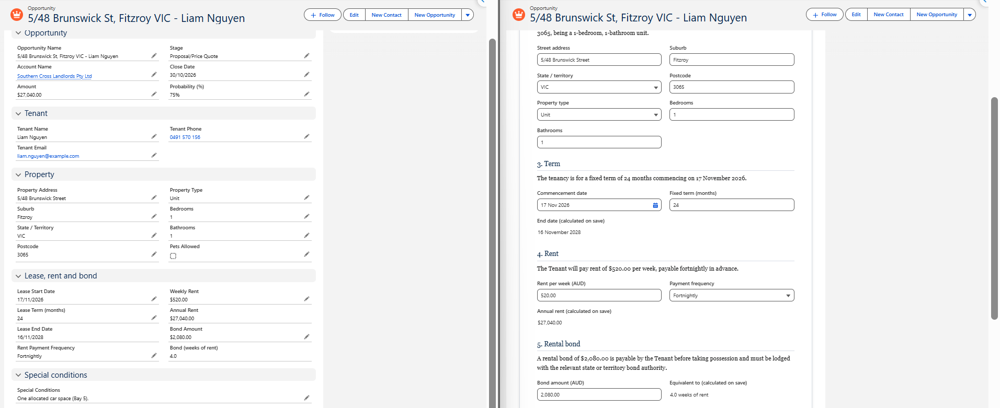
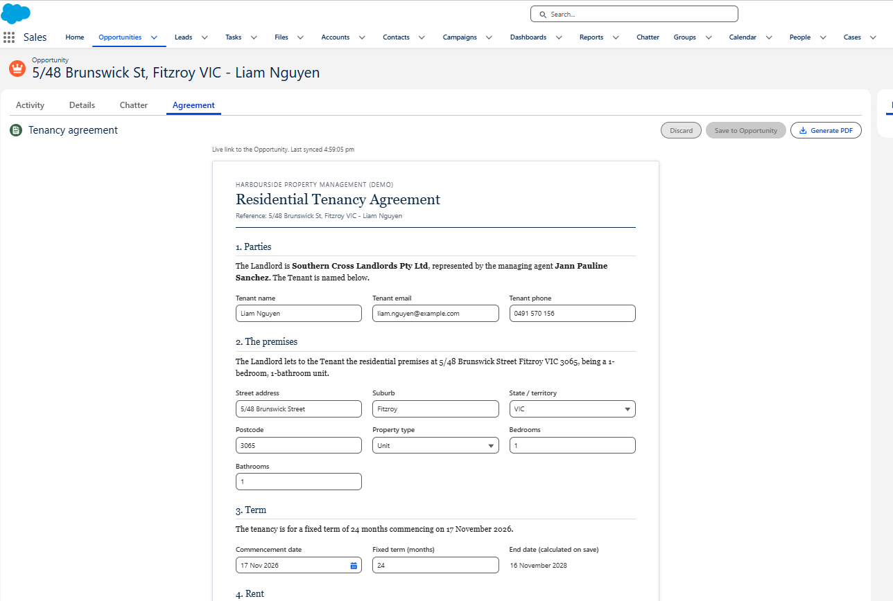
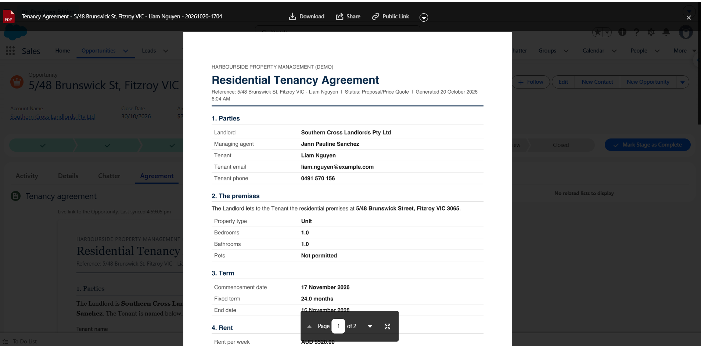

# AU Rental Document Generator (Salesforce)



An Opportunity-driven **tenancy agreement document** for an Australian property-management agency, where the document and the Opportunity are two views of the same data:

- Edit the Opportunity (Details tab, list view, Flow, API, another user) and the document updates live.
- Edit the document and press **Save to Opportunity** and the Opportunity record is updated.
- **Generate PDF** saves a dated snapshot to the Opportunity's Files, which is the copy you send out for signature.

**Built with:** Lightning Web Components, Lightning Data Service, Change Data Capture (`lightning/empApi`), Apex (user-mode security, tests), Visualforce PDF rendering, validation rules, formula fields, permission sets, Salesforce DX.

| Agreement document | Generated PDF |
|---|---|
|  |  |

Industry: residential rentals in Australia. Opportunity = one prospective tenancy; Account = the landlord; Opportunity owner = the managing agent.

> Demo only. The agreement text and the bond rule are illustrative, not legal advice. Each state and territory has its own prescribed tenancy forms and bond rules.

---

## How the two-way sync works

| Direction | Mechanism |
|---|---|
| Opportunity changed on the same page (Details tab, inline edit) | Lightning Data Service (LDS): the component uses `getRecord`, so it re-renders when the cached record changes. |
| Opportunity changed anywhere else (other user, Flow, API, list view, data load) | **Change Data Capture**: the component subscribes to `/data/OpportunityChangeEvent` with `lightning/empApi`, and on a matching record calls `notifyRecordUpdateAvailable` so LDS re-fetches. |
| Document changed | Edits are held as a local draft. **Save to Opportunity** calls `updateRecord` with only the changed fields. Validation rules come back and are shown at the top of the document. |
| Formula fields (end date, annual rent, bond weeks) | Calculated by Salesforce, so they refresh after each save and are labelled "calculated on save". |
| Someone else edits while you have unsaved changes | Your draft is kept, a yellow banner appears, and saving overwrites only the fields you changed (last write wins). Fields where both sides converge on the same value drop out of your draft automatically. |
| Opportunity is Closed (won or lost) | The document becomes read-only. |

The PDF is a **snapshot**: a PDF file cannot write back to Salesforce. The live, editable document is the Lightning component.

## Project layout

```
force-app/main/default/
  objects/Opportunity/fields/            20 fields (17 editable + 3 formulas)
  objects/Opportunity/validationRules/   VIC bond cap, "Closed Won needs tenant + start date"
  permissionsets/Rental_Agreement_Demo   FLS + Apex class + Visualforce page access
  platformEventChannelMembers/           enables Change Data Capture for Opportunity
  lwc/rentalAgreementDoc/                the editable, synced document
  classes/RentalAgreementPdfController   saves the PDF to Files (+ test class)
  pages/RentalAgreementPdf.page          PDF layout (Visualforce renderAs="pdf")
scripts/apex/seed-data.apex              5 sample tenancies across NSW, VIC, QLD, WA
optional/layouts/                        page layout that shows the new fields on the Details tab
config/project-scratch-def.json          scratch org definition (AU country, Developer edition)
docs/screenshots/                        images used in this README
```

---

## Set up a demo org

You need the [Salesforce CLI](https://developer.salesforce.com/tools/salesforcecli) (`sf`). VS Code is optional but handy. Pick **Option A** (scratch org, cleanest) or **Option B** (free Developer Edition).

### First: get the project onto your computer (both options)

1. Get the code. Either clone it (`git clone <this repo's URL>`) or use **Code > Download ZIP** on the GitHub page and unzip it.
2. In VS Code: **File > Open Folder...** and choose the project folder: the one that directly contains `sfdx-project.json`. If you downloaded a ZIP, the project can end up one folder deeper than you expect, so check for `sfdx-project.json` before continuing.
3. Open the built-in terminal: **Terminal > New Terminal**. It opens already inside the project folder. Every command below is run here.
4. Check the CLI works: `sf --version`. You should see a version number. If you get "command not found", close and reopen VS Code, then try again.

### Option A: scratch org

You need a Dev Hub. Any Developer Edition org can be one: Setup > Development > Dev Hub > enable.

```bash
sf org login web --set-default-dev-hub --alias devhub
sf org create scratch --definition-file config/project-scratch-def.json --alias rental-demo --set-default --duration 14
```

### Option B: free Developer Edition

1. Sign up at <https://developer.salesforce.com/signup> and verify the email.
2. Setup > Company Settings > Company Information: check **Default Currency** is Australian Dollar (change it if not) and set your time zone in your personal settings.
3. Log the CLI in to your new org. In the VS Code terminal (opened in the project folder, see above) run:

   ```bash
   sf org login web --set-default --alias rental-demo
   ```

   - Your browser opens a Salesforce login page. Sign in with your **Developer Edition username** (it looks like an email address but is the one you were given at sign-up) and the password you set from the verification email. Your normal email address will not work unless it is also the username.
   - Click **Allow** on the "Salesforce CLI wants to access your account" screen.
   - Go back to the terminal. It prints "Successfully authorized ... with org ID ...".
   - Confirm it worked: `sf org list`. You should see `rental-demo` with a `(U)` marker, meaning it is the default org.

   You do not create a scratch org in Option B. Go straight to the next section.

### Deploy, assign access, load data (both options)

Run from the project folder:

```bash
sf project deploy start
sf org assign permset --name Rental_Agreement_Demo
sf apex run --file scripts/apex/seed-data.apex
sf apex run test --class-names RentalAgreementPdfControllerTest --result-format human --wait 10
```

If the deploy stops on the `platformEventChannelMembers` file, delete that file, redeploy, and enable Change Data Capture by hand: Setup > Integrations > Change Data Capture > move **Opportunity** to Selected Entities > Save.

### Optional: show the new fields on the Details tab

The document works without this, but the "edit the Opportunity, watch the document change" demo needs the fields on a layout.

```bash
sf project deploy start --source-dir optional
```

Then Setup > Object Manager > Opportunity > Page Layouts > **Page Layout Assignment** > Edit Assignment > select all rows > choose **Rental Layout** > Save.

If you prefer not to deploy it, edit the existing Opportunity Layout and drag in the new fields instead.

### Put the document on the Opportunity page

1. `sf org open`, go to **Sales** app > Opportunities, open **Unit 4, 12 Wattle St, Newtown NSW**.
2. Gear icon > **Edit Page**.
3. Add the component as its own tab, so the document and the Details tab are one click apart:
   1. In the canvas, click the **Tabs** component (the strip that says Details / Activity / Related).
   2. In the properties panel on the right, click **Add Tab**.
   3. On the new tab, set the label dropdown to **Custom** and type `Agreement` as the label.
   4. In the component list on the left, type `Rental` in the search box. **Rental Agreement Document** appears under **Custom**.
   5. Drag it into the empty drop area of the new **Agreement** tab.

   If your page has no Tabs component, drag **Rental Agreement Document** into the main (centre) column instead.
4. **Save** > **Activate** > **Assign as Org Default** > Desktop > Save.
5. Back on the record, open the **Related** tab: generated PDFs will appear under **Files**.

---

## Demo script (about 5 minutes)

Open the same Opportunity in **two browser windows side by side**: window 1 on the Details tab, window 2 on the document.

| Step | What you do | What to point out |
|---|---|---|
| 1. Opportunity to document | In window 1, change **Weekly Rent** from 720 to 760 and save. | Window 2's document text and rent field update without a refresh, and the green "Updated just now" badge appears. Annual rent changes too. |
| 2. Document to Opportunity | In window 2, change **Tenant phone** and the **Fixed term** to 24, then press **Save to Opportunity**. | Window 1's Details tab shows the new values, and **Lease End Date** has been recalculated. |
| 3. Validation | Open **5/48 Brunswick St, Fitzroy VIC**. Set **Bond amount** to 3000 and press **Save to Opportunity**. [Step-by-step below](#step-3-in-detail-bond-validation). | The VIC bond rule blocks the save and the error shows inside the document. |
| 4. Conflict handling | In window 2 type a new suburb but do not save. In window 1, change the stage. | Yellow banner: someone changed the record, your draft is kept. |
| 5. Fill the gaps | Open **8 Banksia Cl, Fremantle WA**. Add a start date and tenant email in the document. | The enquiry is completed straight from the document. |
| 6. Stage rules | On that record, set **Stage** to Closed Won with no start date, then add the date and retry. | Validation fires, then succeeds, and the document locks (read-only). |
| 7. PDF | Open **27 Jacaranda Ave, West End QLD** and press **Generate PDF**. | A dated PDF opens in file preview and is saved under Files, so each press creates a version. |
| 8. Closed record | Open **Unit 9, 33 Harbour View Tce, Glebe NSW** (Closed Won). | The lock banner and read-only fields. |

### Step 3 in detail: bond validation

Starting values for this record: **Weekly Rent $520.00**, **Bond $2,080.00** (4 weeks). One month's rent is 520 x 52 / 12 = **$2,253.33**, so any bond above that is blocked.

1. Open **5/48 Brunswick St, Fitzroy VIC** in both windows. Window 1: **Details** tab. Window 2: **Agreement** tab.
2. In window 2, scroll to **5. Rental bond** and change **Bond amount (AUD)** from `2080` to `3000`. The clause above the field updates as you type to "A rental bond of $3,000.00 is payable...", and a **1 unsaved** badge appears next to the buttons at the top right.
3. Press **Save to Opportunity** (blue button, top right of the card).
4. Expected result:
   - No green "Saved" toast.
   - A red banner appears at the top of the document reading: *For VIC properties with rent of $900 per week or less, the bond cannot exceed one month's rent (demo rule).*
   - The **1 unsaved** badge stays, and your `3000` stays in the field so you can correct it.
   - In window 1, the Details tab still shows **$2,080.00**: nothing was written to the Opportunity.
5. Change **Bond amount** to `2200` and press **Save to Opportunity** again.
6. Expected result:
   - Green toast: **Saved to Opportunity**. The red banner clears.
   - Window 1 now shows **Bond Amount $2,200.00** and **Bond (weeks of rent) 4.2**.
   - In window 2, **Equivalent to (calculated on save)** reads `4.2 weeks of rent`.
7. Optional, to show the exemption: in window 2 set **Rent per week** to `950` and **Bond amount** to `3000`, then save. It succeeds because the cap only applies to VIC rent of $900 per week or less. Setting **State / territory** to `NSW` with a 3000 bond also saves, because the rule is VIC only.

Reset the record afterwards by setting Rent per week back to `520` and Bond amount to `2080`, or re-run the seed script.

Stage meanings used in the demo (standard Opportunity stages, no renaming needed):

| Salesforce stage | Rental meaning |
|---|---|
| Prospecting | New enquiry |
| Qualification | Application received |
| Proposal/Price Quote | Lease offered |
| Negotiation/Review | Lease out for signing |
| Closed Won | Leased (document locks) |
| Closed Lost | Withdrawn (document locks) |

---

## Data model

| Field | Type | Editable in document |
|---|---|---|
| Tenant_Name__c, Tenant_Email__c, Tenant_Phone__c | Text / Email / Phone | Yes |
| Property_Address__c, Property_Suburb__c, Property_Postcode__c | Text | Yes |
| Property_State__c | Picklist (NSW, VIC, QLD, WA, SA, TAS, ACT, NT) | Yes |
| Property_Type__c | Picklist (House, Apartment, Townhouse, Unit, Studio) | Yes |
| Bedrooms__c, Bathrooms__c, Lease_Term_Months__c | Number | Yes |
| Weekly_Rent__c, Bond_Amount__c | Currency | Yes |
| Lease_Start_Date__c | Date | Yes |
| Rent_Payment_Frequency__c | Picklist (Weekly, Fortnightly, Monthly) | Yes |
| Pets_Allowed__c | Checkbox | Yes |
| Special_Conditions__c | Long text | Yes |
| Lease_End_Date__c, Annual_Rent__c, Bond_Weeks__c | Formula | Read-only (calculated) |

Standard fields also editable from the document: Stage and Close Date.

## Troubleshooting

| Symptom | Fix |
|---|---|
| `InvalidProjectWorkspaceError` ("does not contain a valid Salesforce DX project") | Your terminal is not in the folder that contains `sfdx-project.json`. Open that folder in VS Code (often one level deeper after unzipping). |
| Component not in the App Builder list | Confirm `sf project deploy start` succeeded, then reload App Builder. |
| Fields blank or "insufficient access" | Assign the permission set: `sf org assign permset --name Rental_Agreement_Demo`. |
| Edits from another window don't appear live | Check Change Data Capture has **Opportunity** selected. Same-window edits sync regardless. |
| Generate PDF fails with a page access error | The permission set grants the Visualforce page; make sure it is assigned to the user running the demo. |
| Seed script fails on a field | The fields must be deployed first (`sf project deploy start`). |

## Limitations

- `lightning/empApi` live refresh works in Lightning Experience desktop. It is not supported in the Salesforce mobile app.
- Concurrency is last-write-wins on the fields you edited; there is no record locking.
- The PDF cannot be edited back into Salesforce. A signed copy would be uploaded to Files or sent through an e-signature tool.
- The bond cap is VIC only and illustrative. It follows [Consumer Affairs Victoria's guidance](https://www.consumer.vic.gov.au/housing/renting/rent-bond-bills-and-condition-reports/bond/bond-payments-and-amounts): a bond generally can't exceed one month's rent unless weekly rent is over $900 or VCAT sets a higher amount. The rule treats one month as weekly rent x 52 / 12, because the guidance doesn't spell out the calculation, and it ignores VCAT orders and rooming houses. Add rules for other states after checking current legislation.

## Ideas to extend it

- Auto-save on field blur instead of the Save button.
- Tenants as Contacts via Opportunity Contact Roles, with a multi-tenant signature block.
- Record-triggered Flow that sets Amount = annual rent x term and creates inspection tasks when the stage reaches Closed Won.
- E-signature (for example DocuSign) on the generated PDF, with the signed copy stored on the Opportunity.
- Experience Cloud portal where tenants complete their own details in the same document.
- Document templates per state or territory, switched by `Property_State__c`.
